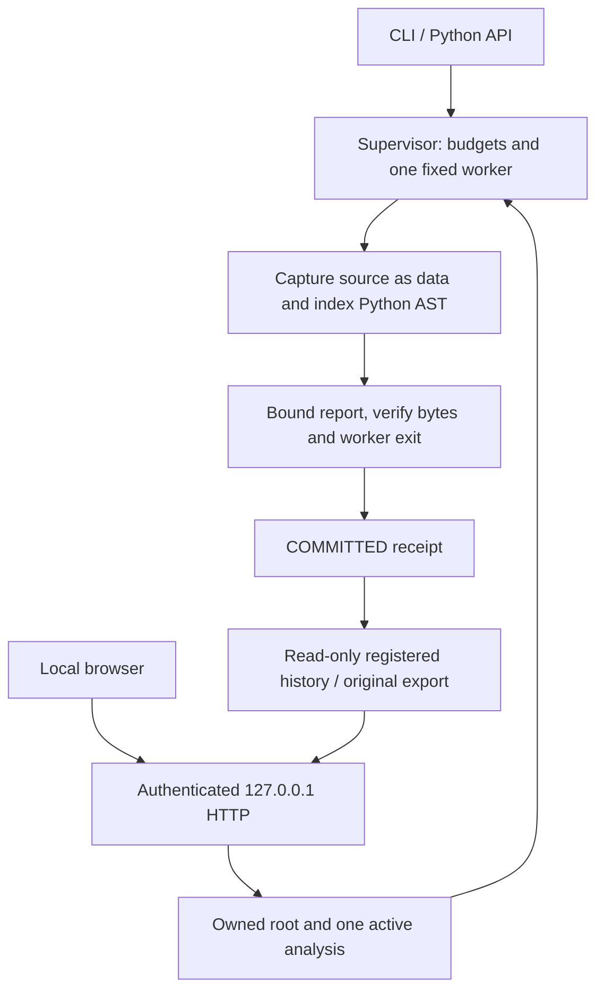

# Multi-Agent Code Review Lab

[](LICENSE)
[](https://github.com/Oliveryfaso/multi-agent-code-review-lab/actions/workflows/offline-core.yml)
[](https://github.com/Oliveryfaso/multi-agent-code-review-lab/actions/workflows/mock-recovery.yml)
[](https://github.com/Oliveryfaso/multi-agent-code-review-lab)
[](https://github.com/Oliveryfaso/multi-agent-code-review-lab/commits)

A local code review and Debugger research lab. Its current usable path turns a repository, reading question and source locations into **bounded static source evidence** through a CLI, Python API or local browser workbench. Agent/provider experiments remain separate from this source-reading path.

## Quick start

From a trusted checkout with an existing CPython 3.12 interpreter; no installation, runtime dependencies or Node build are needed:

```sh
git clone https://github.com/Oliveryfaso/multi-agent-code-review-lab.git
cd multi-agent-code-review-lab
python3.12 -I -S -B cli/agent_review.py evidence-ui
```

Manually open the complete loopback address printed by the command. Keep its session credential private. Nothing is analyzed until submission. The default owned data root is `~/Library/Application Support/MACR Evidence`; use APFS. **Exit workbench** requests cleanup; closing a tab alone does not cancel analysis.

For the CLI, substitute an actual project/entry and a new output directory outside that project:

```sh
mkdir -p ../macr-evidence
python3.12 -I -S -B cli/agent_review.py evidence-locate \
  --repo ../my-python-project --entry src/api.py:Service.handle \
  --question 'Show the captured handler declaration.' \
  --out ../macr-evidence/reading-001 --json
```

The target must be separate from the trusted product package. Exit `0` means requested reading completed; `1` retains partial evidence with gaps. Other outcomes preserve input, resource, cancellation or failure distinctions.

## What it provides

- Captured source with exact physical lines, symbol identity and excerpt completeness.
- Python AST/symbol indexing and limited syntactic facts, with explicit unresolved evidence.
- Separate reported-frame and unique-source counts; no inferred runtime proof.
- Local phase/elapsed time, cancellation, retained history and original JSON/Markdown exports.

## Architecture



## Scope and validation

The static path calls no model and never imports, runs, tests, builds or installs target code. It does not diagnose root causes, repair files or certify repository correctness. Other source types may be inventoried as text; Python AST is the current semantic boundary. Process isolation and monitored budgets are not an OS sandbox or hard kernel quotas.

Native acceptance used macOS ARM64 / APFS / CPython 3.12.13. Package metadata declares Python 3.10+; Ubuntu Python 3.11 CI verifies offline/loopback behavior. Native pressure/RSS monitoring is currently Darwin-specific. Windows and network/shared/ExFAT workbench roots are unsupported.

External-project evidence is retained in separately frozen batches.
The [current Mac record](docs/external-project-validation-current-mac.md) covers
fixed checks for slots 1–6 and 7–8 across two batches; it is not a single-batch 8/8 PASS.
Earlier FAIL and INCOMPLETE verdicts remain unchanged in the
[historical scope](docs/architecture.md#validation-scope).
Outermost CPU, an independent deadline-qualified exit upper bound and sustained-load
behavior remain unverified; the dated records retain all remaining limits.
Local reports contain source/input and must stay private; never expose the workbench publicly.

## DeepSeek policy research

A separate research harness compares four bounded diagnostic strategies over twelve author-known synthetic development cases. The final 29-cell remainder was fully processed: 21 contract-accepted outputs and eight recorded failures. All versions together used 67 requests; historical unknown cost reservations remain held. Post-hoc audits and real evidence retrieval do not establish general accuracy or a causal benefit from tools. Frozen runs are not repaired or rescored. See the [experiment protocol](docs/deepseek-policy-experiment-v1.md), [aggregate results and limits](docs/deepseek-policy-results.md), [provider contract](docs/deepseek-provider-compatibility.md), and [live-run checklist](docs/deepseek-policy-pilot-checklist-v1.md).

The [paired-study harness](docs/deepseek-paired-study.md) provides default-off
contract fixtures and full-denominator reporting. A separately approved nine-task
execution processed 36 cells in 90 requests; its [frozen aggregate results](docs/deepseek-neutral-study-results-20261029.md)
retain eleven failures, the two-segment identity gap and small-sample limits.
These observations do not establish general accuracy or an isolated tool benefit.

A later [R/U regression and paired-study report](docs/deepseek-ru-results-20261030.md)
records 33 requests: R met its machine gate, while U stopped after three contract
failures with 14 cells unattempted. Its locked semantic review does not establish
a policy increment.

## Documentation

- [CLI, Python API, profiles and report semantics](docs/static-evidence.md)
- [Local workbench, history and cancellation](docs/evidence-workbench.md)
- [Architecture, trust boundaries and optional local installation](docs/architecture.md)
- [Architecture assessment](docs/architecture-assessment.md), [documentation maintenance](docs/documentation-maintenance.md)
- [Bounded regression commands and CI](docs/offline-ci.md), [workflow](.github/workflows/offline-core.yml)
- [Security notes for the separate legacy viewer](SECURITY.md)

A pinned source snapshot of this project is included in XERJ Corpus Hub, with attribution to [Oliveryfaso](https://hub.xerj.org/contributors/Oliveryfaso).

MIT licensed; see [LICENSE](LICENSE).
