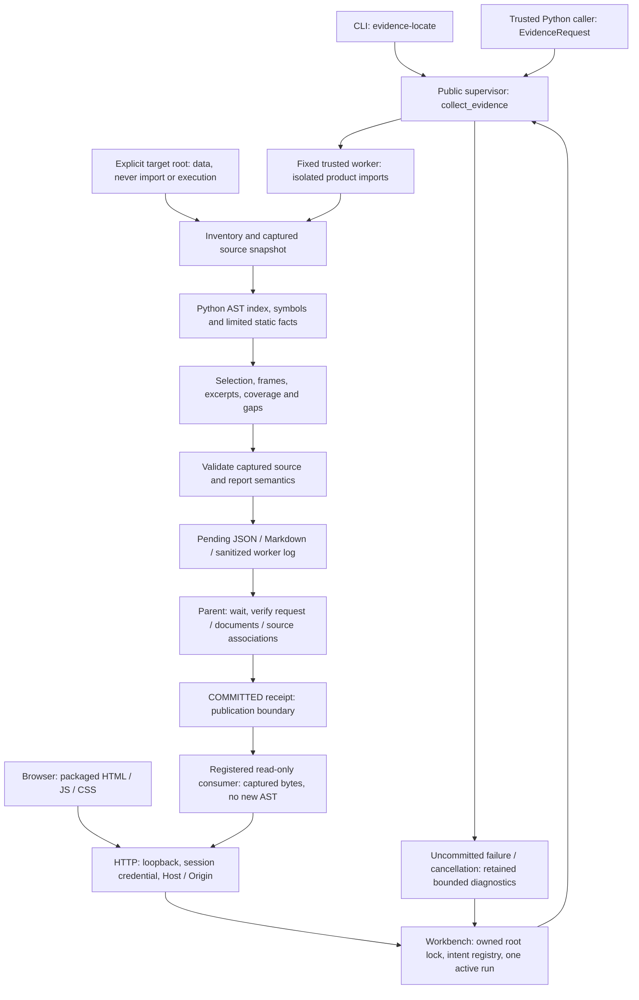
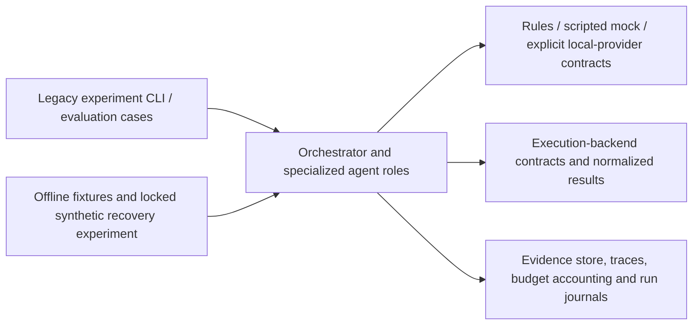

# Architecture and trust boundaries

This document describes the static evidence workbench introduced in [44b1890](https://github.com/Oliveryfaso/multi-agent-code-review-lab/commit/44b1890c12af4dbbe2b58adbc1006e3901264e8d). It is a source-reading product within an agent research repository. Its successful outcome is a bounded, source-associated reading with explicit gaps, not a diagnosis, repaired repository or autonomous agent task.

## Static evidence control and data flow



The CLI and Python API enter the supervisor directly. The browser adapter adds ownership, history, submission identity and shutdown coordination around the same supervisor. There is no provider/model dispatch in this path.

| Component | Source | Responsibility |
| --- | --- | --- |
| CLI and contracts | [`evidence_cli.py`](../src/macr/evidence_cli.py), [`evidence_records.py`](../src/macr/investigation/evidence_records.py), [`evidence_profiles.py`](../src/macr/investigation/evidence_profiles.py) | Validate explicit inputs, canonical request shape, profile values and structured outcomes. |
| Supervisor | [`evidence_supervisor.py`](../src/macr/investigation/evidence_supervisor.py) | Start at most one fixed worker, observe pressure/RSS/storage, carry cancellation, confirm exit and verify before publication. |
| Capture and analysis | [`scope.py`](../src/macr/investigation/scope.py), [`snapshots.py`](../src/macr/investigation/snapshots.py), [`index.py`](../src/macr/investigation/index.py), [`static_facts.py`](../src/macr/investigation/static_facts.py), [`static_evidence.py`](../src/macr/investigation/static_evidence.py) | Inventory permitted source, capture bytes, parse Python, select source and explicitly preserve missing/partial evidence. |
| Worker and publication | [`evidence_worker.py`](../src/macr/investigation/evidence_worker.py), [`evidence_workspace.py`](../src/macr/investigation/evidence_workspace.py) | Validate preparation, stage bounded documents and return their associations; only the parent publishes `COMMITTED`. |
| Workbench owner | [`evidence_workbench.py`](../src/macr/api/evidence_workbench.py) | Hold an owned-root lock, register intent/run identity, serialize analysis, persist lifecycle and prevent unknown-closure replay. |
| Saved report consumer | [`evidence_reader.py`](../src/macr/api/evidence_reader.py) | Verify original receipts, report/manifest/captured bytes and displayed excerpts without rereading the current target or rebuilding AST. |
| Local transport and UI | [`evidence_http.py`](../src/macr/api/evidence_http.py), [`evidence_ui/`](../src/macr/api/evidence_ui) | Serve three fixed assets, authenticate local API operations and present real state/source/history/exports. |

## Publication and lifecycle

Preparation validates the captured source and its semantic observations. The worker then stages documents and returns bounded control data. A normal worker exit alone is insufficient: the parent rechecks request identity, document bytes, source associations, effective resource usage and output state before writing a `COMMITTED` receipt. Pending files cannot be exposed as successful workbench evidence.

The original staged JSON records worker-render usage. The supervisor's returned report also includes final closure and cumulative parent/worker accounting. These measurements are related but not identical; history/export preserves the original document bytes rather than silently regenerating a report from current files.

The owner permits one active analysis with no automatic queue, retry or restart. Intent identity prevents an uncertain submission from becoming a second analysis; the browser queries the original intent. Cancellation is cooperative, with owned-process TERM/KILL/wait cleanup where required. A cancel acknowledgement does not itself prove closure. A valid committed result survives a later cancellation request. Unknown closure blocks further analysis and survives startup; saved PIDs are never used as authority to kill an unrelated process.

History includes only registered outputs. The reader verifies the receipt, effective profile, documents, manifest and every captured file within a shared read budget, including exact displayed excerpt bytes. It does not re-prove the original semantic analysis or guarantee against later external tampering. Missing, damaged, version-unsupported and read-budget-stopped records stay explicit and are not replaced with current working-tree source.

## Language, resource and security boundaries

Python's AST provides syntax and symbol structure for the interpreter actually running the parser. The current facts are limited syntactic observations and ordinary one-hop parameter mappings. They do not evaluate guards/defaults/decorators, prove dynamic dispatch or propagate runtime values. Other source types may be inventoried or retained as text, but do not gain language semantics from that inventory. Parse failure or unsupported syntax is a tool limitation, not a finding that the target is defective.

V2 reported frames and unique selected source units are different entities: multiple valid physical frames may resolve to one declaration, and a valid frame may still have incomplete source. Coverage, omitted candidates, completeness and required gaps must accompany any evidence count.

The supervisor currently uses Darwin read-only system APIs for host pressure and worker RSS. The real native path was exercised on macOS ARM64 / APFS / CPython 3.12.13. Non-Darwin monitoring is unavailable and fails closed. Ubuntu Python 3.11 offline/loopback CI and Linux filesystem fixture recognition do not establish Linux native analysis support. The package's Python 3.10+ declaration is not a verified platform/interpreter matrix.

Resource controls monitor elapsed time, source/AST size, IO, cumulative metadata work, physical owned output, free space and worker memory. The standard 120-second analysis / 5-second cleanup targets and sampling cadence are not hard kernel quotas. Repeated monitoring consumes cumulative metadata budget; a small retained tree can still exhaust it. The manual workbench `standard-capacity` preset changes only standard's metadata limits to 100000 entries / 16 MiB. It does not broaden source authority, relax pressure checks or guarantee completion.

The worker runs trusted product code under a controlled import path; target source is parsed as data. This is not a sandbox for running untrusted code. Target roots must not overlap the trusted package; keep output outside the target and use a separately owned output root. Protected paths, symlinks and unsupported roots remain excluded irrespective of a larger budget.

The HTTP adapter binds only `127.0.0.1` at an ephemeral port. All API operations require the session credential and exact Host; POST additionally requires exact Origin. Four connection slots are acquired before request threads, with bounded headers/body/socket time. There is no CORS, directory serving, arbitrary-path source endpoint or external asset. Captured text is rendered as text. The local data root and exports can contain private source and input; they are never public telemetry.

Detailed limits and report semantics live in the [static evidence guide](static-evidence.md) and [workbench guide](evidence-workbench.md). The older unauthenticated auxiliary viewer described by [SECURITY.md](../SECURITY.md) is a separate route.

## Separate agent research paths



These modules support research into coordination, evidence use, persistence and evaluation. The public core keeps host execution closed; approved machine-specific execution/service orchestration is not bundled. An external local HTTP provider requires an explicitly configured, separately managed service; no model/runtime launcher is included. Remote fallback is disabled by default. A scripted provider or synthetic recovery pass does not validate a deployed model, arbitrary repair, end-to-end agent reliability or production isolation.

Python owns the current parser, contracts, supervisor and local server; JavaScript/HTML/CSS own the browser interaction. Architecture quality depends on those contracts, bounded failures and measured task outcomes. A new language or runtime needs a concrete module requirement and acceptance evidence; language count alone is not a reason to replace a working boundary.

## Validation scope

The [dated architecture assessment](architecture-assessment.md) compares mature projects by module needs. The [documentation maintenance guide](documentation-maintenance.md) records when related docs and diagrams must be checked together.

At the 2026-10-15 release checkpoint, bounded contracts passed 99 static / 41 workbench / 10 JavaScript cases; selected legacy core and TCP lifecycle passed 366 / 5 cases. The exact public commit's [Offline Core](https://github.com/Oliveryfaso/multi-agent-code-review-lab/actions/runs/38709486820) and [Mock Recovery](https://github.com/Oliveryfaso/multi-agent-code-review-lab/actions/runs/38709486817) CI succeeded. These suites have different trust and native-dispatch scopes.

The installed C3 candidate exercised two native completed/partial cases with real pressure/RSS and independent process identities/waits. Four browser scenarios exercised completed, partial, cancelled and a genuine standard metadata-budget failure. A later zero-analysis supplement verified UI shutdown, actual wait and PID/port closure on the integrated workspace. An older installed candidate's 24-slot native pass is historical evidence, not the revised public tree's full native matrix.

Known failed candidates remain failed. A tool connection loss left an earlier browser observer's final independent record incomplete; later observations cannot reconstruct that historical gap. Native receipts, captured source, session credentials and browser logs stay private rather than being committed to make the public repository appear more completely qualified.

The [second external real-project attempt](external-project-validation.md) stopped before CLI/worker startup on actual Darwin host pressure `warning` / raw `2`; all eight slots remain unrun, with no retry. Sustained/larger-load performance and an exact-public-tree full native matrix remain unverified. Linux native workers/monitoring and ExFAT durability are unverified; the current implementation refuses ExFAT workbench roots. No model/VM/target-execution or autonomous repair acceptance is implied.


## Optional local installation

The [README source launcher](../README.md#quick-start) needs no installation. To obtain the `agent-review` entry point, use an isolated environment containing `pip` and the pinned build backend, `setuptools==72.1.0`. With those prerequisites already available locally, run from the trusted checkout:

```sh
/local/tools/macr-env/bin/python -m pip --isolated install \
  --no-index --no-deps --no-build-isolation --no-cache-dir .
/local/tools/macr-env/bin/agent-review evidence-locate --help
/local/tools/macr-env/bin/agent-review evidence-ui
```

`/local/...` paths are placeholders. This command does not fetch missing build tools or dependencies; prepare them from trusted local wheels first or use the source launcher. No global install is required. Runtime dependencies are empty; optional `mock-recovery` dependencies serve the separate synthetic experiment. The [static evidence guide](static-evidence.md#api-and-report) provides the Python `EvidenceRequest` / `collect_evidence` example and cooperative cancellation contract.
